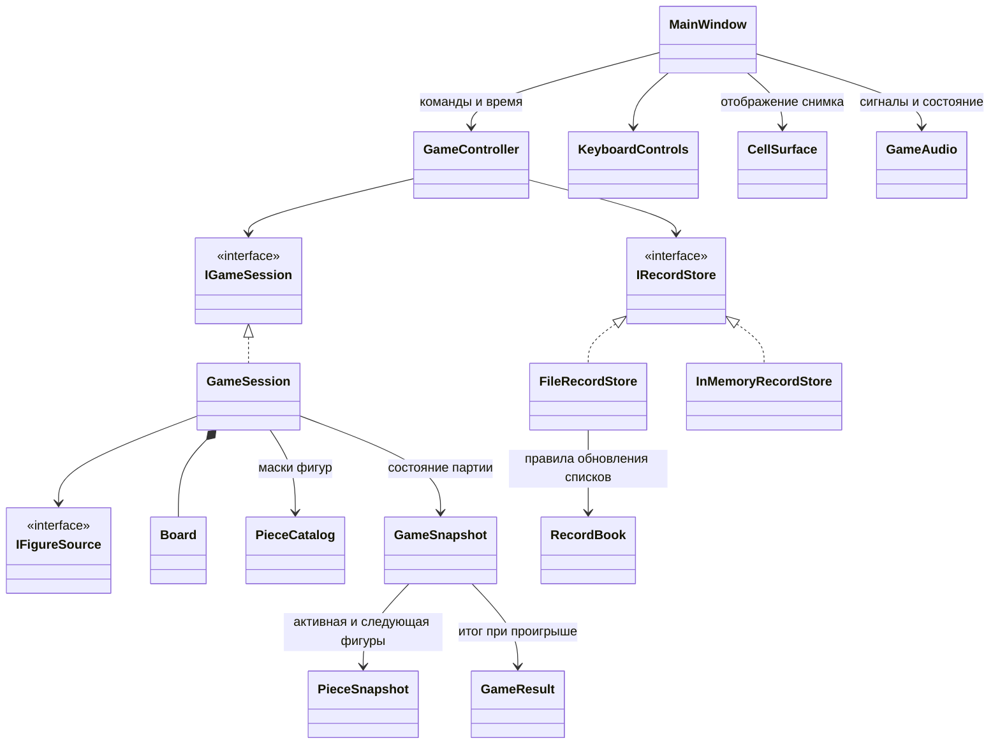

# Архитектура игры с падающими фигурами

Логическая модель описывает текущую реализацию. Игровые правила и критерии приёмки приведены в [спецификации](spec.md), определения терминов — в [глоссарии](GLOSSARY.md).

Решение `Tetris.slnx` объединяет проект ядра `Tetris.Core` (`net10.0`) и настольный проект `Tetris.Desktop` (`net10.0-windows`, WPF). Зависимость направлена от окна и адаптеров к ядру. Ядро получает команды и интервалы времени и работает без окна.

## Части программы

| Проект | Пространство имён | Ответственность |
|---|---|---|
| `Tetris.Core` | `Tetris.Core.Gameplay` | Состояние партии, поле, формы, правила движения и поворота, игровое время, закрепление, очистка строк, очки и завершение партии |
| `Tetris.Core` | `Tetris.Core.Records` | Данные результата, порядок сортировки и правила обновления списков «Последние 10» и «Топ-5» |
| `Tetris.Desktop` | `Tetris.Desktop` | `App.xaml` задаёт точку входа и ресурсы. `MainWindow` обрабатывает ввод, измеряет время и обновляет интерфейс. |
| `Tetris.Desktop` | `Tetris.Desktop.Application` | Запуск партии, передача команд, экраны приложения и сохранение завершённых результатов |
| `Tetris.Desktop` | `Tetris.Desktop.Presentation` | Сопоставление клавиш с командами, отрисовка поля, палитры, демонстрационное поле меню и звук |
| `Tetris.Desktop` | `Tetris.Desktop.Storage` | Чтение и запись локальных рекордов |

`GamePhase` хранит состояние партии (`Ready`, `Running`, `Paused`, `Lost`, `Abandoned`). `AppScreen` хранит экран приложения (`Menu`, `Game`, `Results`, `Records`). Пауза — состояние партии и слой на игровом экране. Открытие рекордов из паузы меняет экран и сохраняет состояние `Paused`.

## Основные классы и интерфейсы

| Элемент | Что хранит или делает |
|---|---|
| `IGameSession` | Контракт ядра. Позволяет запустить партию, передать команду, продвинуть время, прочитать `Snapshot` и подписаться на `LinesCleared`. |
| `GameSession` | Владеет полем, активной и следующей фигурами, состоянием партии, уровнями, счётом, отсчётами падения и закрепления и накопленным временем дэша. Обрабатывает команды и продвижение игрового времени. |
| `Board` | Хранит сетку закреплённых клеток 10 × 20. Проверяет допустимость размещения, закрепляет клетки и удаляет заполненные строки. Занятые клетки хранят тип фигуры, чтобы интерфейс мог перекрасить их при смене уровня. |
| `PieceCatalog` | Хранит исходные маски и строит зеркальные варианты для пяти типов. |
| `PieceSnapshot` | Представляет активную или следующую фигуру через номер типа, координаты и текущую маску. |
| `IFigureSource` | Задаёт выбор типа и зеркальной формы. Вложенный в `GameSession` `WeightedFigureSource` использует взвешенный выбор с одной повторной попыткой при совпадении с предыдущим типом. |
| `GameSnapshot` | Снимок поля, активной и следующей фигур, текущего уровня, счёта, общего числа очищенных строк и состояния партии. При проигрыше содержит `GameResult`. |
| `GameResult` и `RecordEntry` | Результат партии содержит итоговый счёт, активное время и начальный уровень. Запись рекорда добавляет дату и идентификатор. |
| `GameController` | Передаёт команды и интервалы времени в ядро, выбирает экран и инициирует сохранение при проигрыше. |
| `KeyboardControls` | Сопоставляет физические клавиши обеих схем с командами движения, поворота и дэша. |
| `CellSurface` и `MenuPreview` | `CellSurface` рисует поле и предпросмотр из клеток. `MenuPreview` задаёт демонстрационную раскладку главного меню. |
| `GameAudio` | Управляет фоновым циклом и эффектами через WPF `MediaPlayer`. Выбирает скорость фоновой музыки по текущему уровню. |
| `RecordBook` | Обновляет оба списка. «Последние 10» идут в обратном порядке сохранения. Топ-5 сортируется по убыванию счёта, затем по возрастанию приведённого времени и затем по порядку сохранения. |
| `IRecordStore` | Контракт чтения и обновления рекордов. Штатный запуск использует `FileRecordStore`. `InMemoryRecordStore` хранит данные в памяти для отдельной проверки. |

## Связи между классами

## Взаимодействие во время партии

`MainWindow` измеряет прошедшее время через `Stopwatch` и передаёт его контроллеру на тиках `DispatcherTimer` и при обработке игрового ввода. Ядро отсчитывает падение, закрепление, время дэша и повторы сдвига. Для сдвига и дэша передаются нажатие и отпускание. `Esc` обрабатывается в окне. При паузе ядро сбрасывает удерживаемые команды и замораживает игровое время. После возобновления удерживаемую клавишу нужно отпустить и нажать снова.

При закреплении `Board.LockAndClear` вычисляет очищенные строки. `GameSession` начисляет очки на уровне до очистки, обновляет уровень и проверяет стартовую позицию следующей фигуры. Если место свободно, той же фигуре из предпросмотра передаётся ход. При заблокированной позиции снимок получает `Lost` и `GameResult`. Ядро публикует `LinesCleared` с числом строк, очищенных при одном закреплении, после обновления снимка.

Контроллер обнаруживает `Lost`, переключает экран на `Results`, публикует `GameEnded` и сохраняет `RecordEntry`. При ошибке записи запись остаётся в очереди контроллера с тем же идентификатором для повторной попытки. Выход через меню паузы переводит партию в `Abandoned` и возвращает главное меню.

## Отрисовка и звук

`MainWindow` передаёт `CellSurface` снимок поля и текущий уровень. Цвет клетки зависит от типа и уровня. `GameAudio` получает состояние партии и текущий уровень. При `LinesCleared` со значением 4 проигрывается `achievement.mp3`, и громкость фоновой музыки снижается до окончания эффекта. `GameEnded` запускает звук проигрыша. Щелчок привязан к событию `ButtonBase.Click`.

MP3 из `assets/music` копируются в одноимённую подпапку сборки и публикации. Путь к аудио определяется от каталога приложения. Темы из `assets/Dark Green` и `assets/Night Archade` содержат копии `App.xaml`, `MainWindow.xaml` и `Presentation/CellSurface.cs`. Скрипт `switch_theme.py` переносит эти файлы в настольный проект и запускает пересборку.

## Хранилище рекордов

`FileRecordStore` поднимается от каталога приложения до `Tetris.slnx` и использует `db` рядом с файлом решения. Для сборки вне дерева проекта `db` размещается рядом с приложением. `recent.json` хранит последние партии, `top.json` — лучшие. Именованный мьютекс на каталог записей защищает чтение и обновление между экземплярами игры в одном сеансе Windows.

Перед заменой списков сохраняется `pending.json` с их новыми данными. Каждый JSON записывается во временный файл и затем заменяет целевой. После обновления обоих списков журнал удаляется. Если обновление прервалось после записи журнала, следующее чтение или сохранение завершает его.

## Проверка

Обычный запуск создаёт `GameSession` и `FileRecordStore`. Для проверки ядра можно подать заранее заданные типы и формы через `IFigureSource` и передавать интервалы через `Advance`. Для проверки контроллера можно использовать `InMemoryRecordStore`. Для проверки файловой записи используется отдельный каталог. Сценарии проверки конечного поведения приведены в [критериях приёмки](spec.md#критерии-приёмки).
