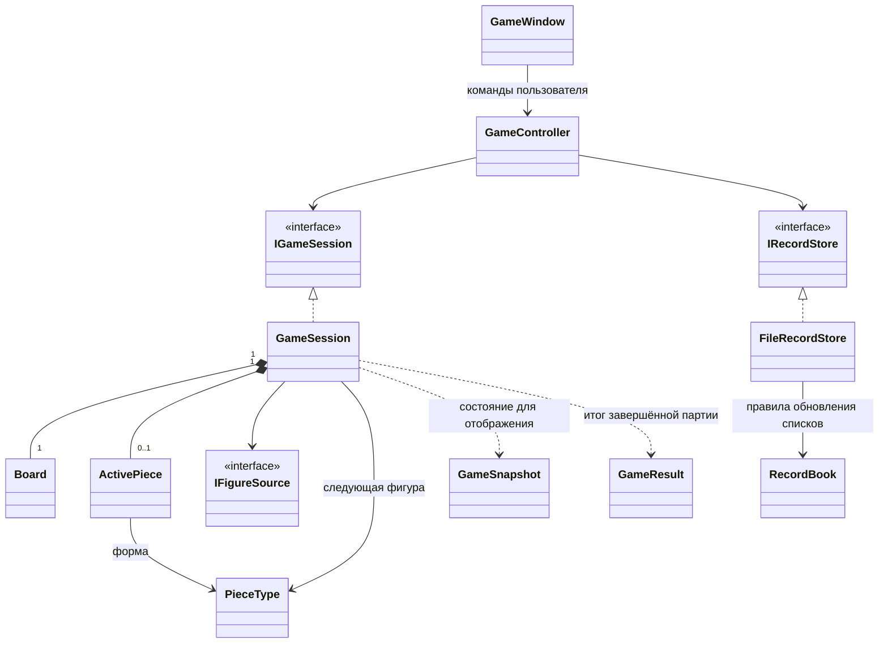

# Логическая модель игры с падающими фигурами

Статус — черновик архитектуры. Игровые правила и критерии приёмки определены в [спецификации v1.0](spec.md). Термины используются в значениях из [словаря](GLOSSARY.md).

Графический интерфейс реализуется на WPF. В XAML описываются игровое поле, панель счёта, предпросмотр и меню паузы поверх поля. Ресурсы оформления задают общие цвета и стили. Правила игры выполняет отдельное ядро на C#.

## Части программы

| Проект | Пространство имён | Ответственность |
|---|---|---|
| `Tetris.Core` | `Tetris.Core.Gameplay` | Состояние партии, поле, формы, правила движения и поворота, игровое время, закрепление, очистка строк, очки и завершение партии |
| `Tetris.Core` | `Tetris.Core.Records` | Данные результата, порядок сортировки и правила обновления списков «Последние 10» и «Топ-5» |
| `Tetris.Desktop` | `Tetris.Desktop.Application` | Запуск партии, обработка команд игрока, переходы между экранами и передача завершённого результата в хранилище |
| `Tetris.Desktop` | `Tetris.Desktop.Presentation` | Окно, клавиатура, отрисовка, палитры, звук и измерение интервала между обновлениями |
| `Tetris.Desktop` | `Tetris.Desktop.Storage` | Загрузка и сохранение двух списков результатов в отдельных локальных файлах |
| `Tetris.Tests` | `Tetris.Tests` | Проверки правил ядра, сортировки и взаимодействия частей |

Настольный проект использует ядро. Ядро принимает игровые команды и интервалы времени и может работать без окна. Поле и время партии меняются внутри игрового ядра. Режимы окна, например главное меню и просмотр таблицы рекордов, принадлежат контроллеру приложения. Состояния партии — идёт, на паузе, завершена проигрышем, прервана.

## Основные классы и интерфейсы

| Элемент | Что хранит или делает |
|---|---|
| `GameSession` | Владеет полем, активной и следующей фигурами, состоянием партии, уровнями, счётом, отсчётами падения и закрепления и накопленным временем дэша. Обрабатывает команды и продвижение игрового времени. |
| `Board` | Хранит сетку закреплённых клеток 10 × 20. Проверяет допустимость размещения, закрепляет клетки и удаляет заполненные строки. Занятые клетки хранят тип фигуры, чтобы интерфейс мог перекрасить их при смене уровня. |
| `PieceType` | Описывает один из 14 типов фигур. У пяти типов номер общий для исходной и зеркальной масок. |
| `ActivePiece` | Представляет фигуру текущего хода через тип, положение и ориентацию. |
| `IFigureSource` | Даёт очередной тип фигуры и признак зеркальной формы. Генератор использует веса из спецификации и один раз повторяет выбор при совпадении с предыдущим типом. У типа с зеркальной формой обе маски равновероятны. В проверках и заглушках можно задать последовательность заранее. |
| `GameSnapshot` | Снимок для чтения. Содержит поле, активную и следующую фигуры, счёт, число очищенных строк, уровень и состояние партии. Изменения состояния ядра выполняются через игровые команды и обновления времени. |
| `GameResult` | Игровые данные завершённой партии — итоговый счёт, активное время и начальный уровень. Дата и идентификатор записи добавляются при подготовке записи для хранилища. |
| `GameController` | Преобразует ввод в игровые команды, передаёт интервалы времени, выбирает экран и инициирует сохранение при переходе партии в состояние проигрыша. |
| `RecordBook` | Формирует оба списка по правилам спецификации. Последние партии идут от новой к старой. Топ-5 упорядочивается по убыванию счёта, затем по возрастанию приведённого времени, затем по очередности записи. |
| `IRecordStore` | Предоставляет приложению операции чтения списков и сохранения одного результата. Основная реализация использует локальные файлы. Для первого запуска подходит реализация в памяти. |

## Связи между классами

## Взаимодействие во время партии

`IGameSession` задаёт операции запуска партии с выбранного уровня, применения команды, продвижения игрового времени и чтения состояния. После обработки действия окно получает актуальный снимок поля. Ядро отдельно сообщает об очистке строк и о проигрыше. Окно использует эти события для звука, а контроллер использует событие проигрыша для сохранения результата. Клавиши обеих схем управления преобразуются в одни и те же команды движения, поворота и дэша.

Контроллер передаёт прошедший интервал времени. Ядро отсчитывает падение, задержку закрепления, время дэша и повтор горизонтального сдвига. Окно передаёт отдельные события нажатия и отпускания клавиш сдвига и дэша. На паузе игровое время и отсчёты падения и закрепления заморожены. После возобновления дэш и повтор сдвига активируются новым нажатием.

После закрепления ядро последовательно обновляет поле, очищает заполненные строки, начисляет очки на уровне до очистки, обновляет уровень и проверяет стартовую позицию следующей фигуры. Если её клетки помещаются, начинается следующий ход. Если они заблокированы, ядро возвращает результат проигрыша. Тогда контроллер подготавливает запись с датой и идентификатором и передаёт её хранилищу один раз за партию. При повторе попытки сохранения используется тот же идентификатор. Выход через паузу переводит партию в состояние прерывания и возвращает главное меню.

## Первый запуск с заглушками

В первом каркасе окно и контроллер работают с интерфейсами `IGameSession` и `IRecordStore`. Заглушка партии — временная реализация `IGameSession`. По команде запуска она выдаёт заранее заданное поле и фигуры с выбранным начальным уровнем. По командам паузы и возобновления она меняет состояние партии. В заранее определённой точке сценария она сообщает о проигрыше и возвращает заданный результат. Хранилище в памяти принимает этот результат и возвращает его при открытии таблицы в том же сеансе.

Сценарий первого запуска проходит от главного меню через запуск, паузу и возобновление к экрану итогов и таблице рекордов. Проверка подтверждает передачу команд, переходы между экранами и совпадение показанных данных с полученными от заглушек.

Движение фигур, столкновения, отсчёт закрепления и начисление очков проверяются после реализации соответствующих правил ядра. После подключения файлового хранилища проверяется восстановление обоих списков при перезапуске.
